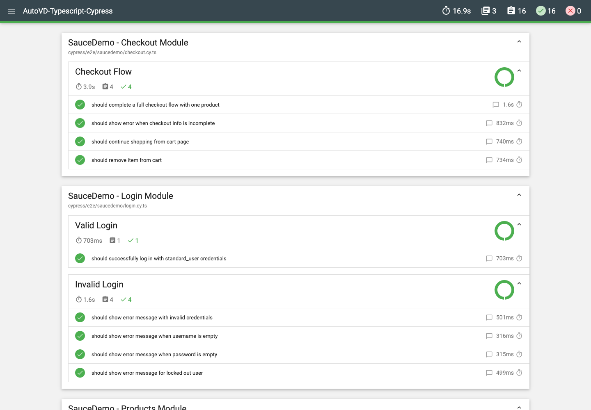

# AutoVD - Cypress + TypeScript Test Framework

[](https://github.com/KMD-Vignesh/AutoVD-Typescript-Cypress/actions/workflows/e2e.yml)
[](https://www.cypress.io/)
[](https://www.typescriptlang.org/)

A modular Cypress + TypeScript framework with page objects, shared login, tagged smoke tests, HTML reporting, strict linting and CI. The included reference suite runs against [SauceDemo](https://www.saucedemo.com).

## Stack

| Concern | Tool |
|---|---|
| Test runner | Cypress 16 |
| Language | TypeScript 5.9 (strict) |
| Structure | Page Object Model |
| Test selection | `@cypress/grep` tags |
| Reporting | `cypress-mochawesome-reporter` |
| Linting | ESLint 10 flat config + `eslint-plugin-cypress` |
| Formatting | Prettier |
| CI | GitHub Actions |

## Requirements

- Node.js 22 (see `.nvmrc`)
- npm 10+

```bash
nvm use
npm ci
```

## Quick start

```bash
npm run test:open      # interactive runner
npm test               # headless, all specs
npm run test:smoke     # only @smoke-tagged tests
npm run verify         # type-check + lint + format check
```

## Scripts

| Script | Purpose |
|---|---|
| `npm test` | Run all specs headlessly |
| `npm run test:smoke` | Run tests tagged `@smoke` |
| `npm run test:open` | Open the Cypress runner |
| `npm run test:headed` | Run with a visible browser |
| `npm run type-check` | `tsc --noEmit` |
| `npm run lint` | ESLint over specs, support and config |
| `npm run lint:fix` | ESLint with autofix |
| `npm run format` | Prettier for code and config |
| `npm run format:check` | Prettier check (used in CI) |
| `npm run verify` | Type-check, lint and format check in one command |

## Project structure

```
.
├── .github/workflows/e2e.yml     # CI: verify, run Cypress, upload artifacts
├── cypress/
│  ├── e2e/saucedemo/             # Specs grouped by feature area
│  ├── fixtures/saucedemo/        # Test data per module
│  ├── page-objects/
│  │  ├── base/BasePage.ts        # Shared navigation
│  │  └── saucedemo/              # One class per page
│  └── support/
│     ├── commands.ts             # Shared login command
│     ├── e2e.ts                  # Reporter and grep registration
│     └── types.d.ts              # Custom command types
├── docs/                         # Detailed guides
├── cypress.config.ts             # Cypress, reporter and grep config
├── eslint.config.mjs             # ESLint flat config
├── tsconfig.json                 # Strict TypeScript config
└── package.json
```

Generated output (`reports/`, `cypress/videos/`, `cypress/screenshots/`) is gitignored.

## How the suite is organized

- **Specs** (`cypress/e2e/<module>/`) contain scenarios and assertions only.
- **Page objects** (`cypress/page-objects/<module>/`) own selectors and page interactions.
- **Fixtures** (`cypress/fixtures/<module>/`) hold static data such as users and checkout details.
- **Shared login** is a custom command: `cy.login(users.validUser)`.
- **Smoke tests** are tagged in the spec: `it('...', { tags: '@smoke' }, () => {})`.

To add a module: create its fixture, page object and spec under the same module name. Tag the critical path `@smoke`.

## Configuration

`cypress.config.ts` reads the target URL from `CYPRESS_BASE_URL` and falls back to `https://www.saucedemo.com`:

```bash
CYPRESS_BASE_URL=https://staging.example.com npm test
```

Tag filtering and spec pre-filtering are configured under `expose`:

```ts
expose: {
  grepFilterSpecs: true,
  grepOmitFiltered: true,
}
```

More detail: [06 - Configuration](docs/06-configuration.md).

## Reports and artifacts

Every run writes an HTML report plus JSON, videos and failure screenshots:



| Artifact | Location |
|---|---|
| HTML report | `reports/index.html` |
| JSON results | `reports/.jsons/` |
| Videos | `cypress/videos/` |
| Failure screenshots | `cypress/screenshots/` |

CI uploads these as the `cypress-artifacts` artifact. See [09 - Reporting](docs/09-reporting.md).

## Documentation

| Doc | Description |
|---|---|
| [01-installation](docs/01-installation.md) | Setup and verification |
| [02-project-structure](docs/02-project-structure.md) | Folder architecture and module rules |
| [03-best-practices](docs/03-best-practices.md) | Cypress and TypeScript practices |
| [04-page-object-model](docs/04-page-object-model.md) | Page object conventions |
| [05-custom-commands](docs/05-custom-commands.md) | Shared login and command patterns |
| [06-configuration](docs/06-configuration.md) | Cypress, TypeScript, ESLint and env config |
| [07-fixtures-test-data](docs/07-fixtures-test-data.md) | Test data management |
| [08-ci-cd-integration](docs/08-ci-cd-integration.md) | CI pipeline and artifacts |
| [09-reporting](docs/09-reporting.md) | Reports, screenshots and videos |
