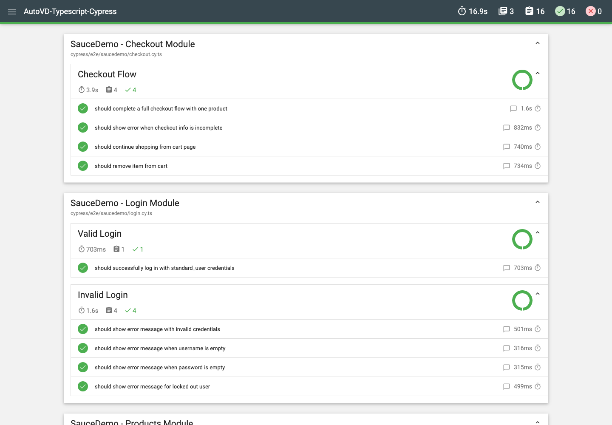

# 09 - Test Reporting

The framework uses `cypress-mochawesome-reporter`. Reports are generated automatically on every run; no merge step is required.

---

## How it is wired

`cypress.config.ts`:

```typescript
import { defineConfig } from 'cypress';
import initPlugin from 'cypress-mochawesome-reporter/plugin';

export default defineConfig({
  e2e: {
    setupNodeEvents(on, config) {
      initPlugin(on, config);
      return config;
    },
    reporter: 'cypress-mochawesome-reporter',
    reporterOptions: {
      reportDir: 'reports',
      charts: true,
      reportPageTitle: 'AutoVD Cypress Report',
      embeddedScreenshots: true,
      inlineAssets: true,
      saveAllAttempts: false,
    },
  },
});
```

`cypress/support/e2e.ts`:

```typescript
import 'cypress-mochawesome-reporter/register';
```

The plugin and the support import are both required. Removing either one produces JSON without the HTML report.

---

## Output

After `npm test`:



| Path | Content |
|---|---|
| `reports/index.html` | Self-contained HTML report |
| `reports/.jsons/*.json` | Raw Mochawesome JSON per spec |
| `reports/videos/` | Copies of run videos |
| `cypress/screenshots/` | Failure screenshots (linked in the report) |

Open the report locally:

```bash
open reports/index.html
```

The report includes:

- Pass/fail counts and duration per spec
- Failure messages and stack traces
- Embedded screenshots for failures
- Charts for pass rate and duration

---

## Screenshots and videos

```typescript
video: true,
videoCompression: 32,
screenshotOnRunFailure: true,
screenshotsFolder: 'cypress/screenshots',
videosFolder: 'cypress/videos',
```

Cypress takes the failure screenshot automatically. Do not add a second screenshot call in `afterEach` or `Cypress.on('fail')`; that creates duplicates and can interfere with the original error.

`embeddedScreenshots: true` requires `inlineAssets: true` for a portable single-file report.

---

## Retries and attempts

`retries.runMode: 1` retries a failing test once. With:

```typescript
saveAllAttempts: false,
```

the report shows the final attempt. Set it to `true` only while diagnosing a flaky test; otherwise the report doubles in size and hides the real failure.

---

## Optional: JUnit XML

Some CI dashboards consume JUnit XML. Install the reporter and run:

```bash
npm install --save-dev mocha-junit-reporter
npx cypress run --reporter mocha-junit-reporter \
  --reporter-options mochaFile=reports/junit/results-[hash].xml
```

Keep Mochawesome as the default. Do not configure two reporters at once; Cypress accepts one per run.

---

## Retention and git hygiene

Generated output is ignored:

```gitignore
reports/
cypress/screenshots/
cypress/videos/
```

Upload these folders as CI artifacts (see `docs/08-ci-cd-integration.md`). Do not commit them.

To keep a run small, disable video locally:

```bash
npx cypress run --config video=false
```

Leave video enabled in CI so a failed run has evidence.

---

## Troubleshooting

| Symptom | Cause | Fix |
|---|---|---|
| Only JSON, no HTML | `initPlugin` missing | Add it to `setupNodeEvents` |
| Report is empty | Reporter support import missing | Import `cypress-mochawesome-reporter/register` in `support/e2e.ts` |
| Screenshots not embedded | `inlineAssets` false | Set `inlineAssets: true` |
| Report grows every run | `overwrite`/attempts config | Keep one report directory and `saveAllAttempts: false` |
| Wrong report location | `reportDir` changed | Update CI artifact path to match |
